<div align="center">
  
  <h1>TweakHub</h1>
  <p><strong>A portable Windows 11 toolkit for power users who configure, rebuild and maintain PCs frequently.</strong></p>
  <p>
    <a href="https://github.com/PrimeBuild-pc/TweakHub/commits/main"></a>
    <a href="https://github.com/PrimeBuild-pc/TweakHub/stargazers"></a>
    <a href="https://github.com/PrimeBuild-pc/TweakHub/issues"></a>
  </p>
  <p>
    <a href="https://github.com/PrimeBuild-pc/TweakHub/actions/workflows/ci.yml"></a>
    <a href="https://github.com/PrimeBuild-pc/TweakHub/releases/latest"></a>
    <a href="https://github.com/PrimeBuild-pc/TweakHub/releases"></a>
    <a href="https://github.com/PrimeBuild-pc/TweakHub/releases"></a>
    
    
    <a href="#languages"></a>
    <a href="LICENSE"></a>
  </p>
  <p>
    <a href="#features"><b>Features</b></a> ·
    <a href="#screenshots"><b>Screenshots</b></a> ·
    <a href="#download--quick-start"><b>Download</b></a> ·
    <a href="#portable-by-design"><b>Portable data</b></a> ·
    <a href="#in-depth"><b>In depth</b></a> ·
    <a href="#build-from-source"><b>Build</b></a>
  </p>
  <br>
  <a id="screenshots"></a>
  <a href="assets/screenshots/security-overview.png">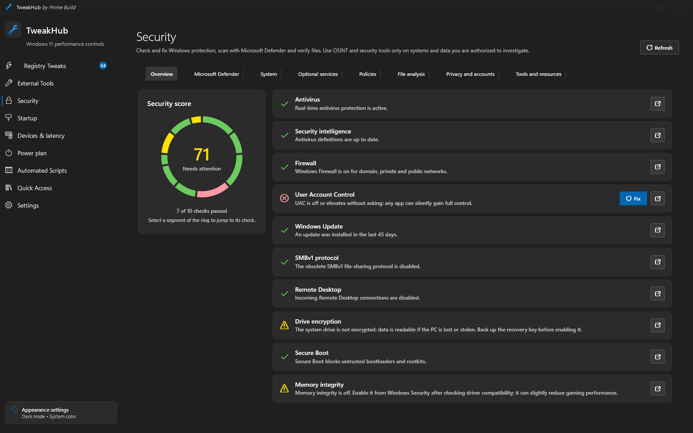</a>
</div>

<table>
  <tr>
    <td align="center"><a href="assets/screenshots/registry-tweaks.png">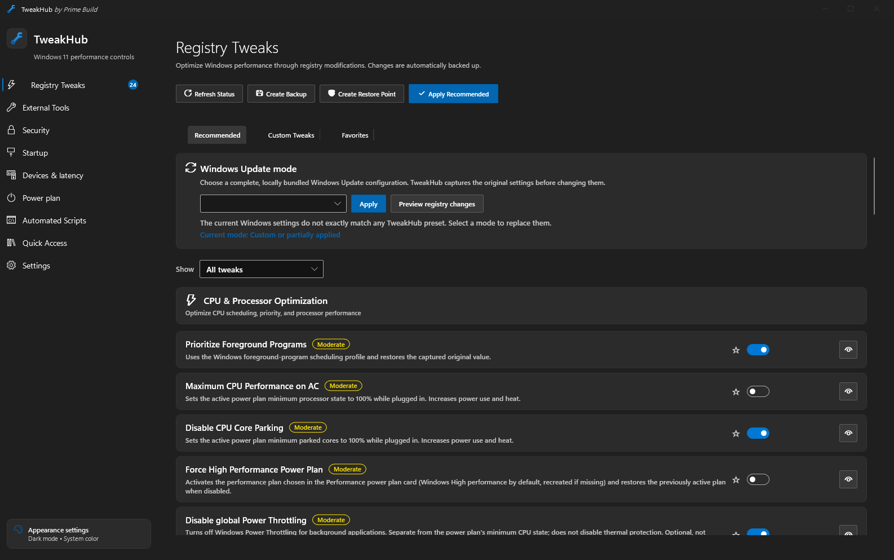</a><br><sub><b>Registry Tweaks</b></sub></td>
    <td align="center"><a href="assets/screenshots/security-overview.png"></a><br><sub><b>Security · Overview</b></sub></td>
    <td align="center"><a href="assets/screenshots/security-privacy.png">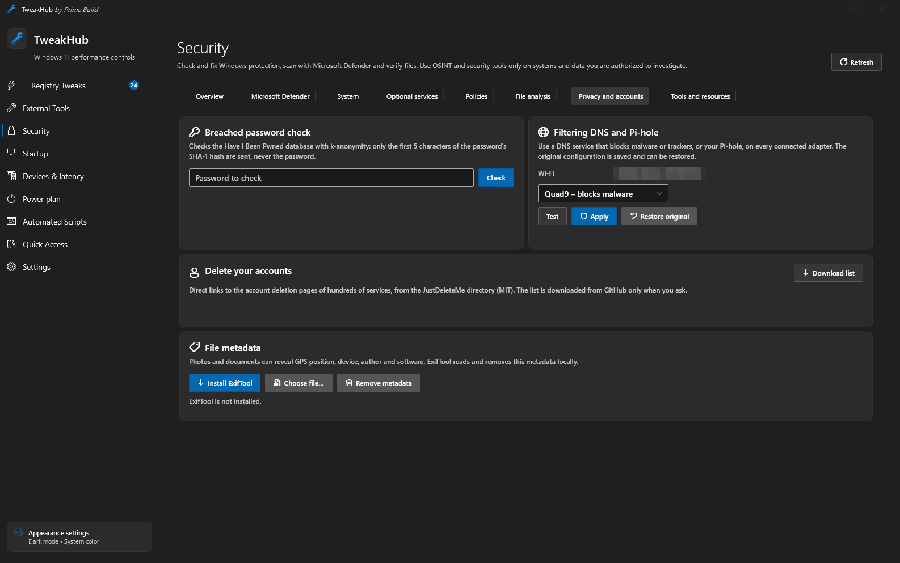</a><br><sub><b>Security · Privacy and accounts</b></sub></td>
    <td align="center"><a href="assets/screenshots/security-tools.png">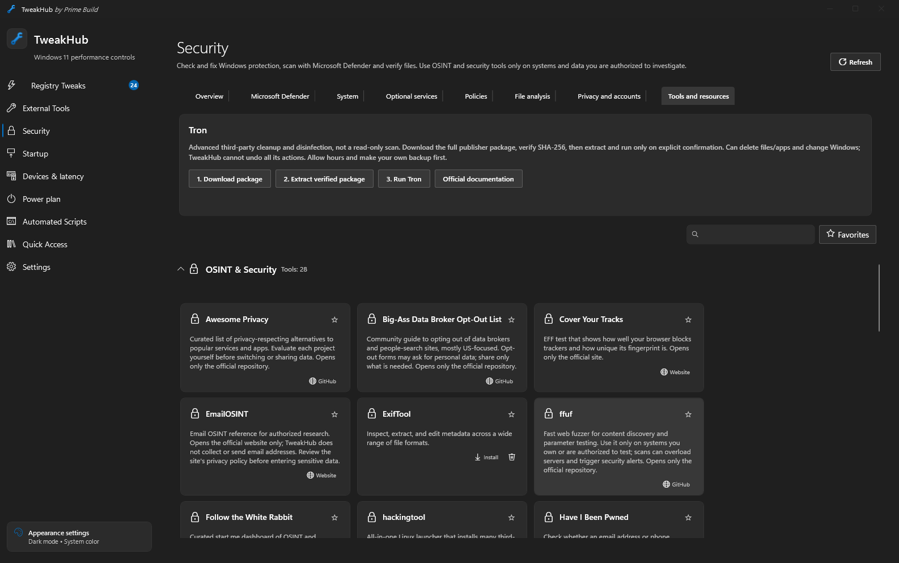</a><br><sub><b>Security · Tools and resources</b></sub></td>
    <td align="center"><a href="assets/screenshots/startup.png">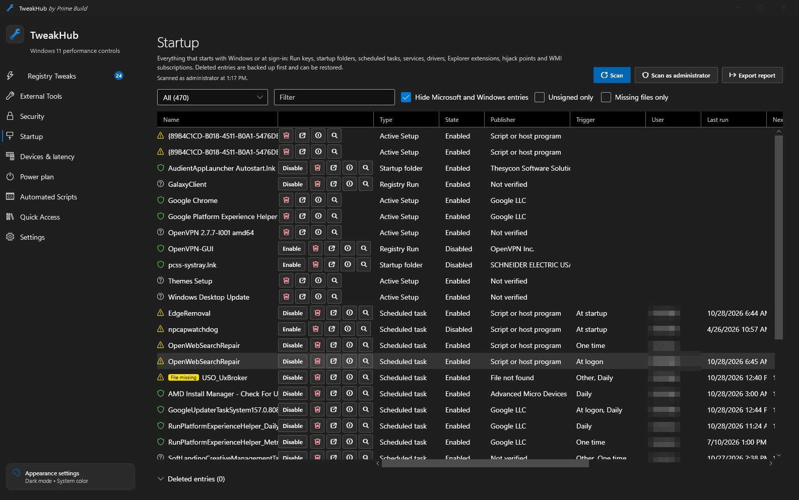</a><br><sub><b>Startup</b></sub></td>
    <td align="center"><a href="assets/screenshots/drivers.png">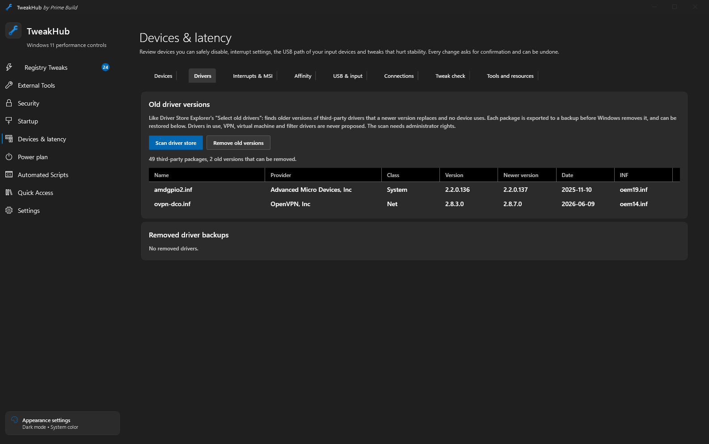</a><br><sub><b>Devices · Drivers</b></sub></td>
    <td align="center"><a href="assets/screenshots/connections.png">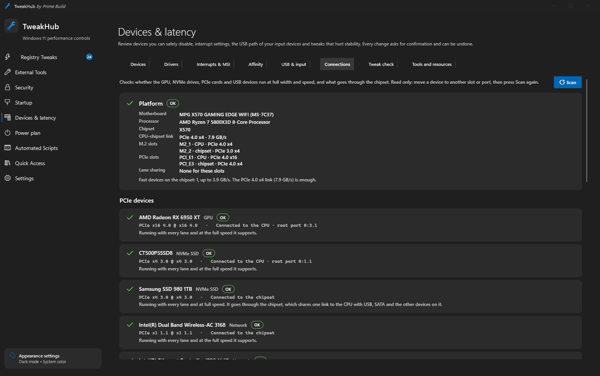</a><br><sub><b>Devices · Connections</b></sub></td>
    <td align="center"><a href="assets/screenshots/devices.png">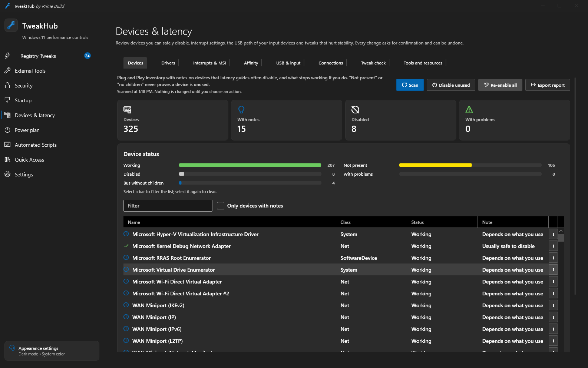</a><br><sub><b>Devices · Inventory</b></sub></td>
    <td align="center"><a href="assets/screenshots/interrupts-msi.png">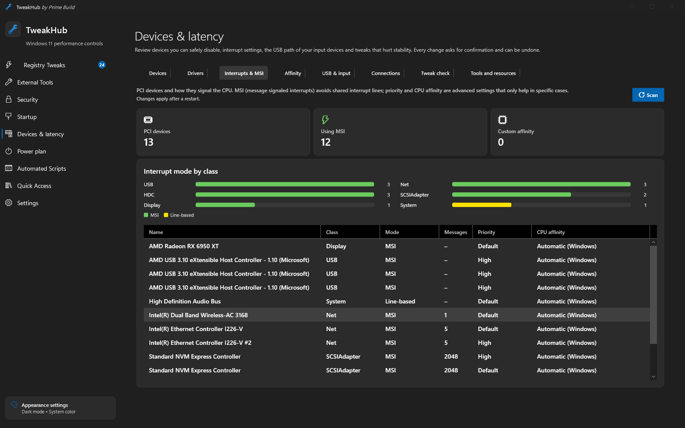</a><br><sub><b>Devices · Interrupts &amp; MSI</b></sub></td>
    <td align="center"><a href="assets/screenshots/usb-input.png">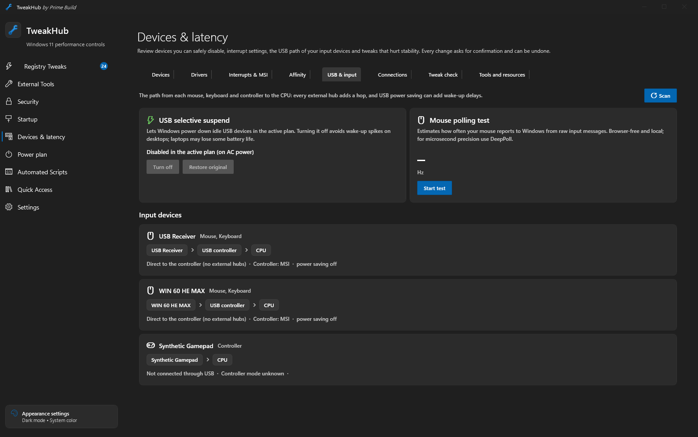</a><br><sub><b>Devices · USB &amp; input</b></sub></td>
    <td align="center"><a href="assets/screenshots/tweak-check.png">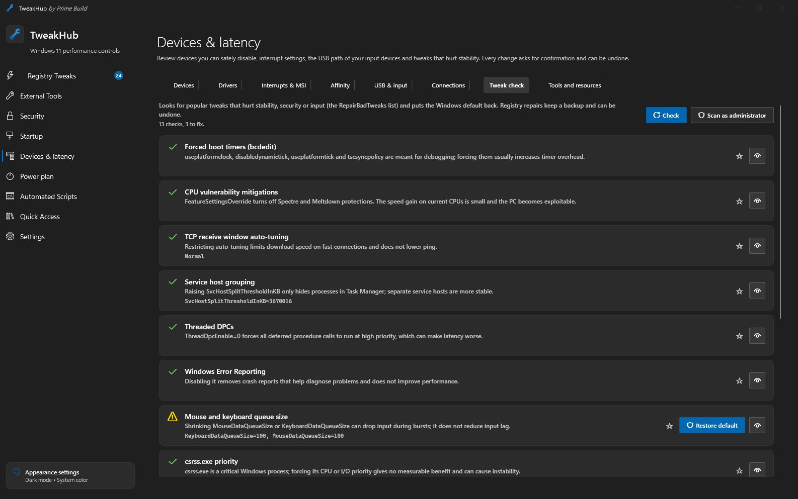</a><br><sub><b>Devices · Tweak check</b></sub></td>
    <td align="center"><a href="assets/screenshots/power-plan.png">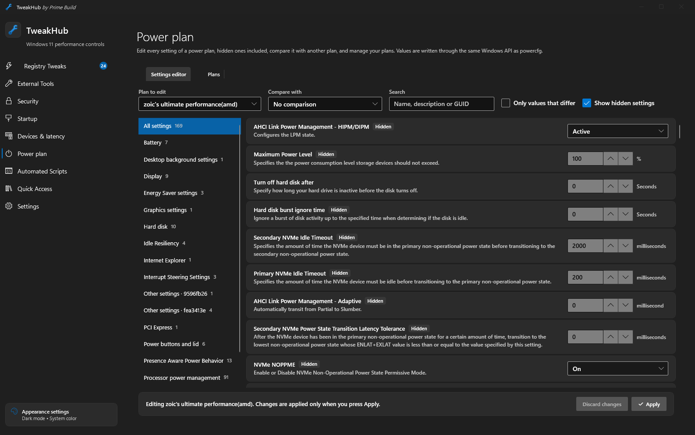</a><br><sub><b>Power plan</b></sub></td>
    <td align="center"><a href="assets/screenshots/automated-scripts.png">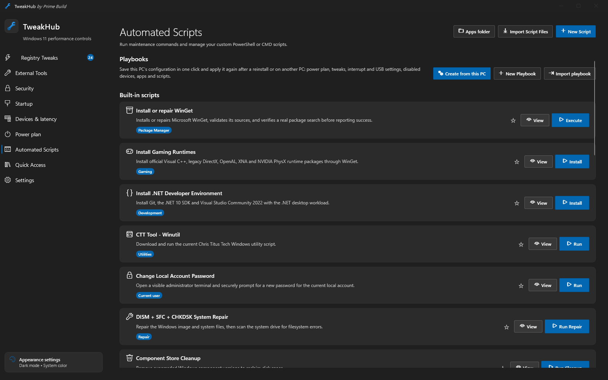</a><br><sub><b>Automated Scripts</b></sub></td>
    <td align="center"><a href="assets/screenshots/external-tools.png">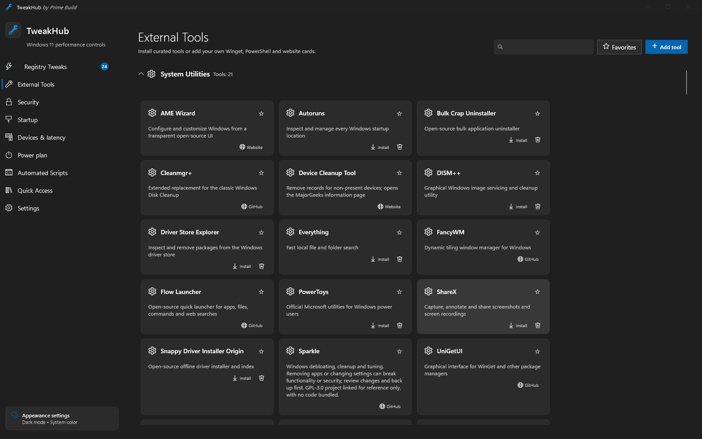</a><br><sub><b>External Tools</b></sub></td>
    <td align="center"><a href="assets/screenshots/quick-access.png">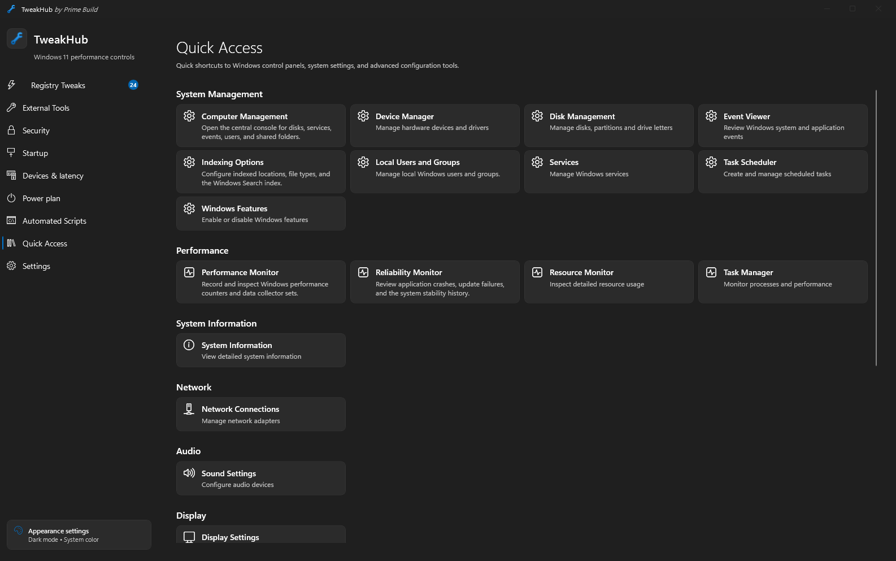</a><br><sub><b>Quick Access</b></sub></td>
    <td align="center"><a href="assets/screenshots/settings.png">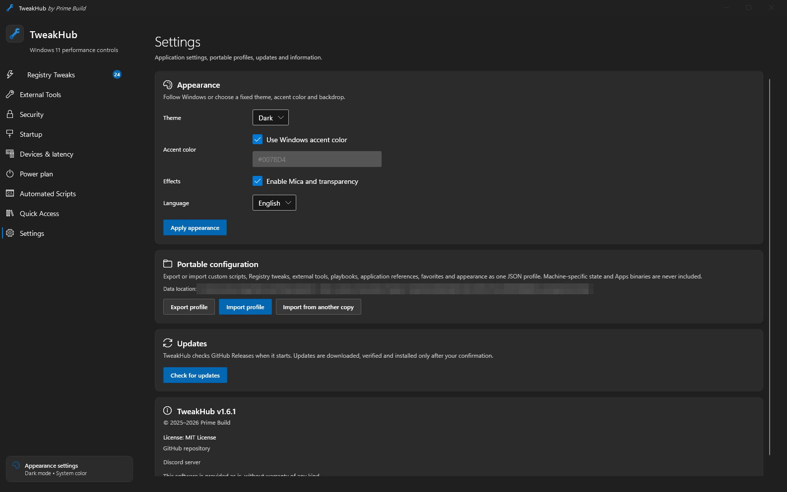</a><br><sub><b>Settings</b></sub></td>
  </tr>
</table>

<p align="center"><sub>Scroll the gallery sideways (swipe on touch screens) and click any screenshot to open it at full size.</sub></p>

> [!WARNING]
> **Use at your own risk.** TweakHub is intended for experienced technicians and power users as a fast way to review and apply selected system changes. It is not a one-click optimizer, and its tweaks should never be applied blindly.
>
> Some settings and scripts can reduce stability, performance or security, cause data loss, prevent Windows or connected hardware from working correctly, or—in exceptional cases—damage hardware. Review every preview, research changes you do not fully understand, and create a restore point and a verified backup before proceeding. You are solely responsible for the changes you apply and their consequences; to the maximum extent permitted by law, the authors and contributors accept no liability for damage to software, data or hardware.

## Why TweakHub?

TweakHub is built to live on a USB drive. Extract it once, add your preferred tools, scripts, Registry tweaks, favorites and appearance settings, then carry the complete folder between PCs. Your portable configuration stays with the app instead of being scattered across every machine you maintain.

It runs as the current user and requests administrator privileges only when an operation requires them. Supported tweaks provide previews, backups and restoration. External tools and destructive maintenance scripts can make changes that TweakHub cannot undo.

## Features

<table>
  <tr>
    <td width="50%" valign="top">
      <h3>⚡ Registry tweaks</h3>
      Curated Windows 11 tweaks for CPU scheduling, network latency, privacy, telemetry and Windows AI, each with a preview, automatic backup, verification and rollback. Includes a Windows Update mode selector and an optional low-latency network preset per adapter.
    </td>
    <td width="50%" valign="top">
      <h3>🛡️ Security</h3>
      A security score with ten checks and one-click fixes, Microsoft Defender scans, network connections and startup entries with their digital signature, local file hashing, breached password check, filtering DNS and a curated OSINT catalog.
    </td>
  </tr>
  <tr>
    <td valign="top">
      <h3>🖱️ Devices &amp; latency</h3>
      Device inventory with notes on what is safe to disable, MSI mode and interrupt priority per PCI device, the USB path of every mouse and keyboard, a mouse polling test and a check that undoes popular tweaks that hurt stability.
    </td>
    <td valign="top">
      <h3>🔌 Connections <sup>new</sup></h3>
      Shows whether the GPU, NVMe drives and PCIe cards run at full width and speed, whether they hang off the CPU or the chipset, the negotiated USB speed of each device and the M.2 and slot wiring of 180+ motherboards.
    </td>
  </tr>
  <tr>
    <td valign="top">
      <h3>🔋 Power plan</h3>
      Edit every setting of a power plan, hidden ones included, compare two plans side by side, and create, duplicate, rename, import or export plans through the same Windows API as <code>powercfg</code>.
    </td>
    <td valign="top">
      <h3>🤖 Automation &amp; repair</h3>
      Playbooks that capture this PC's configuration and apply it again elsewhere, built-in maintenance scripts, a DISM + SFC + CHKDSK repair workflow and portable PowerShell/CMD scripts with preview, elevation, timeout and cancellation.
    </td>
  </tr>
  <tr>
    <td valign="top">
      <h3>🧰 Toolbox &amp; quick access</h3>
      Categorized WinGet packages, trusted HTTPS links, your own tool cards, and the Windows administration consoles and control panels in one place.
    </td>
    <td valign="top">
      <h3>🎒 Portable &amp; updatable</h3>
      Everything lives beside the executable and moves as one JSON profile. In-app updates are confirmed by you and verified with SHA-256; a new copy can import everything from an old one.
    </td>
  </tr>
</table>

New in 1.6.1:
- **Windows Update "Security" mode:** security updates are no longer deferred, but nothing downloads, installs or restarts by itself: Windows notifies you, and you download, install and restart. Drivers stay excluded and feature updates are deferred for 365 days. A clean Windows install is now recognized as "Default". On Windows Home, TweakHub explains which parts the edition ignores.
- **Hardening:** elevated script output goes through a private named pipe instead of temporary files, system folder variables are reset in every script, a running service is stopped before it is deleted, and elevated startup scans by another administrator read the right user.
- **Fixes:** a crash when a dialog button was pressed as the dialog closed, 534 translation fixes across the five translated languages, and USB devices in sleep are no longer woken by the Connections scan.

New in 1.6.0:
- **Startup:** an Autoruns-style view of everything that starts with Windows (Run keys, startup folders, scheduled tasks, services, drivers, Explorer extensions, Winlogon, IFEO, WMI) with signatures and missing-file badges. Entries can be disabled or deleted with a backup and restored later; Windows-critical entries are protected.
- **Registry tweaks:** Group Policy power settings that stop automatic sleep, hibernation, disk spin-down and Energy Saver when plugged in, plus an optional tweak that turns sleep off completely. Also optional global Power Throttling control and hibernation management through `powercfg`. Risk badges and a risk filter on every tweak.
- **Devices:** "Disable unused" finds devices this PC does not use (for example the kernel debug adapter, or VPN miniports when no VPN is set up for any user) and disables the ones you tick in one step. A new **Drivers** tab removes old driver versions that a newer version replaces and no device uses, like Driver Store Explorer's "Select old drivers", with a backup of every package and one-click restore. **Affinity** places PCI interrupts on chosen logical CPUs, labelled by physical core and SMT thread.
- **Security:** optional services with individual startup-mode changes and restoration, a Policies tab that lists policies forced by other tools and resets them with a backup, and **Tron** with separate confirmed download, extraction and launch. Tron runs from a folder only administrators can change, after its SHA-256 is checked against the publisher's list. It can make irreversible changes: back up your files first. Microsoft Defender may block the Tron package; TweakHub never adds antivirus exclusions.

Portable does not mean system changes disappear when the app closes: keep the copy's `Data` directory to retain restoration data.

TweakHub supports **Windows 11 build 22000 or newer**.

<a id="languages"></a>The interface and installer support English, Russian, Simplified Chinese, Spanish, Italian and Japanese. TweakHub follows the Windows display language by default; an explicit language can be selected under **Settings**.

## Download & quick start

<div align="center">
  <p>
    <a href="https://github.com/PrimeBuild-pc/TweakHub/releases/latest"></a>
  </p>
</div>

<table>
  <tr>
    <td width="33%" valign="top">
      <h3>🎒 Portable <sup>recommended</sup></h3>
      <ol>
        <li>Download the portable archive from <a href="https://github.com/PrimeBuild-pc/TweakHub/releases/latest">the latest release</a>.</li>
        <li>Extract the complete archive to a USB drive or local folder.</li>
        <li>Run <code>TweakHub.exe</code>.</li>
      </ol>
      Keep <code>TweakHub.exe</code>, <code>portable.flag</code> and the generated <code>Data</code> directory together when moving the app.
    </td>
    <td width="33%" valign="top">
      <h3>💿 Installer</h3>
      A conventional per-PC setup. Installed builds store user data under <code>%AppData%\TweakHub</code> instead of beside the executable.
    </td>
    <td width="33%" valign="top">
      <h3>📦 WinGet</h3>
      Install or upgrade from the terminal:
      <pre>winget install --id PrimeBuild.TweakHub --exact</pre>
    </td>
  </tr>
</table>

> [!NOTE]
> Releases may be unsigned and can trigger a Microsoft Defender SmartScreen warning. Pre-releases (for example `v1.5.0-beta.1`) are published on the [Releases](https://github.com/PrimeBuild-pc/TweakHub/releases) page only, never on WinGet, and are meant for testing.

## Portable by design

The portable folder carries custom tools, scripts, Registry tweaks, favorites, appearance settings, operation logs and rollback data between PCs.

Use **Settings → Portable configuration** to export or import the complete user profile as a `.tweakhub.json` file. Import validates the complete profile before replacing anything and creates a recovery copy of the current profile first. Script and playbook output is written to `Data/Logs` in portable builds.

**Updating keeps everything.** The in-app updater and the installer leave your data in place. If you extracted a new portable copy into a different folder, use **Settings → Portable configuration → Import from another copy** and pick the old folder (or `%AppData%\TweakHub` of an installed build): the profile, the undo backups of the changes the old copy made and the missing programs under `Apps` come over, then TweakHub restarts. Undo files are never overwritten when the new copy already has changes of its own to restore.

<details>
<summary><b>Files in the <code>Data</code> folder</b></summary>
<br>

| File | Purpose |
|---|---|
| `registry-backup.json` | Original Registry values waiting to be restored |
| `power-backup.json` | Original power settings, active power plan and the performance plan chosen in Registry Tweaks |
| `windows-update-backup.json` | Original Windows Update service and scheduled-task states |
| `operations.jsonl` | Registry and power operation audit log |
| `custom-scripts.json` | User-created PowerShell and CMD scripts |
| `custom-tweaks.json` | User-created Registry entries |
| `custom-tools.json` | User-created external-tool cards |
| `playbooks.json` | Ordered user-created tweak, exact-WinGet and custom-script workflows |
| `favorites.json` | Favorite external tools |
| `favorite-tweaks.json` | Favorite built-in and custom Registry tweaks |
| `favorite-scripts.json` | Favorite built-in and custom automated scripts |
| `appearance.json` | Theme, accent and transparency preferences |

</details>

<details>
<summary><b>Intended customization workflow</b></summary>
<br>

1. Put optional portable programs under `Apps` beside `TweakHub.exe`.
2. Create PowerShell or CMD entries under **Automated Scripts**. **Import Script Files** only reads selected `.ps1`, `.cmd` or `.bat` files into new custom scripts; it does not execute them, copy the original files or import a TweakHub profile. Use the paths provided by TweakHub instead of machine-specific absolute paths:

   ```powershell
   & "$env:TWEAKHUB_APPS\MyTool\MyTool.exe"
   ```

   ```bat
   "%TWEAKHUB_APPS%\MyTool\MyTool.exe"
   ```

   `TWEAKHUB_ROOT` also points to the folder containing `TweakHub.exe`. Scripts start in that directory in normal and administrator mode.
3. Create a playbook in **Automated Scripts** and order any built-in/custom tweaks, exact WinGet packages and saved custom scripts you want it to run.
4. Export the complete profile from **Settings**. Copy `Apps` separately if another PC needs the same portable binaries.
5. On the destination PC, import the profile, review unavailable references, populate `Apps` as needed, then preview and run the playbook. Execution stops at the first failed step and saves a log.

An imported script is retained even if its referenced executable is absent. Running it then fails with the missing path; TweakHub never silently removes the script or reports false success.

</details>

<details>
<summary><b>What a profile includes and excludes</b></summary>
<br>

| Profile includes | Profile deliberately excludes |
|---|---|
| Custom scripts, Registry tweaks and external-tool cards | Executables and other files under `Apps` |
| User playbooks and exact WinGet application IDs | Installed-application state |
| Tool, tweak and automated-script favorites plus appearance/language | Registry, power and Windows Update rollback backups |
| Unavailable user references, so they can be repaired later | Operation logs, script history and pending reboot checks |

Successful built-in script runs and pending reboot verification are machine-specific and remain under `%LocalAppData%\TweakHub`; they never travel with the portable profile. After Windows restarts, TweakHub verifies tracked restart-required changes against their expected state and reports verified, failed, partial or unavailable results instead of merely clearing the indicator.

</details>

> [!CAUTION]
> Do not delete backup files before restoring outstanding changes. When moving TweakHub, copy the complete portable folder—not only `TweakHub.exe`. Profile JSON files do not contain the binaries under `Apps`.

## In depth

<details>
<summary><b>🛡️ Security</b></summary>
<br>

The sidebar **Security** section uses built-in Windows features instead of bundling third-party tools:

- **Overview**: a security score with an interactive ring and ten checks (antivirus, definitions, firewall, UAC, Windows Update, SMBv1, Remote Desktop, BitLocker, Secure Boot, memory integrity). **Fix** runs the shown PowerShell command as administrator after confirmation; BitLocker, Secure Boot and memory integrity only open the relevant Windows settings.
- **Microsoft Defender**: protection status, definition and scan freshness, quick/full/offline scans, definition updates and detection history. Microsoft Safety Scanner is downloaded from Microsoft, rejected unless it carries a valid Microsoft signature, and started in detection-only mode (`/N`).
- **System**: active connections and listening ports per process, plus startup and persistence entries (Run keys, Startup folders, non-Microsoft scheduled tasks, automatic services outside the Windows folder, Winlogon changes), each with the file's Authenticode signature. Interactive charts filter the lists; unsigned files and script hosts are listed first; entries can be disabled and re-enabled (Run and Startup folder items through the same StartupApproved switch as Task Manager, scheduled tasks, and services set to Manual with their original start mode restored); a CSV report can be exported. **Scan as administrator** also resolves system process paths.
- **File analysis**: SHA-256/SHA-1/MD5, Authenticode signature and version information are computed locally. VirusTotal and Triage searches open the browser with the hash only; files are never uploaded.
- **Privacy and accounts**: breached password check through Have I Been Pwned with k-anonymity (only the first five SHA-1 characters are sent); account deletion links from the JustDeleteMe directory (MIT), downloaded from GitHub only on request; filtering DNS presets (Quad9, Cloudflare, AdGuard) or a Pi-hole on every connected adapter, with the original configuration (including static IPv6 servers) saved for restore and detection of networks that intercept DNS; photo and document metadata viewing and removal with ExifTool (installed with winget, original kept as `_original`).
- **Tools and resources**: the **OSINT & Security** catalog with section-scoped search and favorites. Sigcheck, privacy.sexy and ungoogled-chromium install with winget; the other references (WPD, TapMap, SecurityToolkit, EmailOSINT, Microsoft Safety Scanner, Follow the White Rabbit, Triage, User Scanner, Awesome Privacy, Pi-hole, Big-Ass Data Broker Opt-Out List, JustDeleteMe, Personal Security Checklist, ffuf, Xalgorix and hackingtool) only open the official HTTPS page. No email address is collected or transmitted by TweakHub. mVolt and Sparkle are in the main **External Tools** catalog.

Review each card's warnings and upstream documentation before using a tool. In particular, mVolt tuning can damage GPU hardware; optional Sigcheck VirusTotal queries/uploads may disclose hashes or files; Safety Scanner is not resident protection; Triage submissions may become public; ffuf, Xalgorix and hackingtool must only be used against systems you are authorized to test. No third-party code or binaries are bundled or reused: SecurityToolkit and mVolt have unverified reuse licensing, and Sparkle and SCSKiller are GPL-3.0 references only. Sergei Strelec WinPE bundles many third-party tools under their own licenses; verify boot ISO checksums before writing them to USB.

</details>

<details>
<summary><b>🖱️ Devices & latency</b></summary>
<br>

The sidebar **Devices & latency** section brings the useful parts of popular latency tools into TweakHub, with backups instead of one-way scripts:

- **Devices**: Plug and Play inventory (working, not present, disabled, problems, buses without children) with notes on devices latency guides often disable, what stops working if you do, and which ones to leave alone (for example HPET and SMBus). Devices can be disabled and re-enabled; everything TweakHub disabled can be re-enabled at once. Inspired by Device-Analyzer v1.
- **Interrupts & MSI**: MSI mode, interrupt priority and CPU affinity per PCI device, as in GoInterruptPolicy, written through the registry backup used by Registry Tweaks and restorable per device. Changes apply after a restart.
- **USB & input**: the path from each mouse, keyboard and controller through external hubs to its USB controller (with the controller's MSI state), USB selective suspend in the active plan and per device, and a local raw-input mouse polling test with a distribution chart. Inspired by Marius Heier's USB Latency Analyzer and DeepPoll.
- **Connections**: read-only link diagnostics. The maximum and current PCIe link of the GPU, NVMe drives and PCIe cards (`PCIe x16 4.0 @ x16 4.0`, as in GPU-Z; Radeon cards are read through AMD ADLX from the installed driver), whether each device is wired to the CPU or the chipset, the CPU–chipset uplink with a warning when fast devices behind the chipset add up to more than it carries, and the negotiated speed of every USB port (USB 3 devices running at USB 2, input devices behind hubs, drives sharing one hub). A table of more than 180 AM4, AM5 and Intel 400–800 series motherboards, taken from the manufacturers' manuals and spec pages, explains M.2 and slot wiring and lane sharing. Move a device to another slot or port, then press **Scan** again.
- **Tweak check**: the RepairBadTweaks list (forced boot timers, disabled CPU mitigations, TCP auto-tuning, input queue sizes, csrss priority, MPO, memory manager values, raw mouse throttle, global timer requests, a locked minimum processor state) with explanations; registry repairs keep a backup and can be undone. Win32PrioritySeparation, Prefetch and SysMain stay managed by Registry Tweaks.
- **Tools and resources**: the **Latency & Input** catalog (GoInterruptPolicy, Marius Heier's tools, hidusbf, Battle Beaver controller overclocking, PowerPlanSettingsEditor, the Advanced Power Options guide, RepairBadTweaks). TweakHub never runs their `irm | iex` scripts; cards only open the official pages.

</details>

<details>
<summary><b>🧠 Memory and privacy tools</b></summary>
<br>

SysMain and Prefetch should normally remain enabled. Disable them only after measurements identify them as the source of a real problem; doing so can make applications and games load more slowly.

**Empty Standby List** requires Microsoft Sysinternals RAMMap from External Tools. Windows uses otherwise free RAM as cache and releases it immediately when applications need it. Emptying cached RAM routinely does not improve FPS or general performance and should not be scheduled.

The device-metadata and Windows Update driver policies affect different content: preventing device companion apps does not block every driver, while the driver exclusion policy omits packages Windows Update classifies as drivers. The Windows Update selector offers Default, Disabled and Security modes from a script bundled with TweakHub; Security keeps quality/security updates on their normal schedule while deferring feature updates for 365 days. High-risk AI removal and third-party hosts-list scripts always require explicit confirmation.

</details>

## Hardware reports

To help improve device detection and motherboard support, run the standalone [`Collect-TweakHub-Hardware.cmd`](Scripts/Collect-TweakHub-Hardware.cmd). It creates a local JSON report on the Desktop after consent, without changing settings or uploading anything. TweakHub and ThreadPilot do not need to be installed or running. See [collection instructions, privacy, limitations and Discord message](docs/hardware-reports.md) before sharing a report.

## Build from source

Requirements: Windows 11 and the .NET 10 SDK.

```powershell
git clone https://github.com/PrimeBuild-pc/TweakHub.git
cd TweakHub
dotnet restore TweakHub.sln
dotnet build TweakHub.sln -c Release --no-restore
dotnet test TweakHub.Tests/TweakHub.Tests.csproj -c Release --no-build --no-restore
dotnet publish TweakHub.csproj -c Release -r win-x64 --self-contained true -o publish-standalone
```

## CI/CD

Every push and pull request to `main` runs the Windows build and tests. A `vX.Y.Z` tag matching the project version publishes the self-contained portable archive, installer and SHA-256 checksums to GitHub Releases. `PrimeBuild.TweakHub` is published on WinGet, and tagged releases automatically submit package updates; pre-release tags such as `vX.Y.Z-beta.N` are marked as pre-releases on GitHub and skip WinGet.

Generated binaries belong in Releases, not in Git.

## Support the project

If TweakHub saves you time, you can support its development here:

[](https://paypal.me/PrimeBuildOfficial?country.x=IT&locale.x=it_IT)

## License

[MIT](LICENSE) — provided as-is, without warranty.

<div align="center">

**Made with ❤️ for Windows power users.**

</div>
